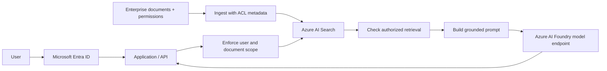

# 01 · Secure Enterprise RAG on Azure

**Status: Conceptual reference design — not yet lab validated.**

**Design decision:** do not let the model decide whether documents are authorized. Validate user context and apply query-time permission trimming, followed by appropriate result verification, **before** inserting retrieved data into a model prompt.

**Controls:** Entra ID, app authorization, scoped workload identities, supported private networking, Key Vault, Purview data classification where integrated, injection-resistant content boundaries, Azure Monitor and audit evidence.

**Caution:** Purview does not automatically enforce arbitrary RAG access control; verify native Azure AI Search ACL capabilities and preview status for your exact design.

[ADR](adr/ADR-001-retrieval-authorization.md) · [Threat model](threat-model/README.md) · [Validation](validation/README.md)
