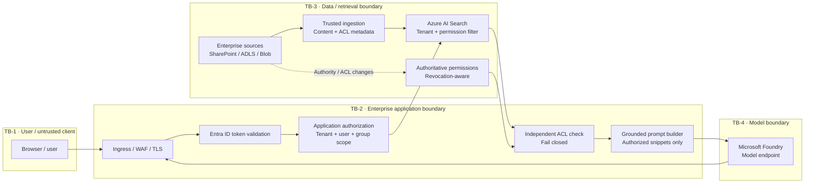

# Secure Enterprise RAG on Azure — Version 2

**The Cloud Security Architect | Azure AI Security Reference Architecture 01**


**Status:** Technical reference design with locally verified *sample* access-control tests; **not** Azure lab-validated and **not** a production deployment.  
**Last technical review:** 2026-10-25 · **Version:** 2.0

> **Central architectural decision:** Authenticate people and services, then authorize the **specific documents** a requester may retrieve **before any excerpts reach the model's context**. Treat the model, indexed text, and citations as untrusted for access control.

## Start here

| Topic | Deliverable |
|---|---|
| **Architecture and trust boundaries** | [Architecture walkthrough and sequence](architecture/README.md) · [Large SVG diagram](../assets/01-rag-trust-boundaries.svg) |
| **Azure service controls** | [Control ownership, configuration, limitations](security-controls/README.md) |
| **Architecture decisions** | [ADR-001: authorization](adr/ADR-001-retrieval-authorization.md) · [ADR-002: permission freshness](adr/ADR-002-permission-freshness.md) |
| **Threat modeling** | [Verified MITRE ATLAS mappings and attack paths](threat-model/README.md) |
| **Validation and proof** | [Negative-security runbook](validation/README.md) · [Runnable offline tests](lab/README.md) |
| **Monitoring** | [Logging, detections and evidence](operations/README.md) |

## The reference solution in one view



**Key boundary:** the Search service's application identity and permission to query indexes do **not** represent the end user's right to read each source document. Validate the user, bind their authorization context server-side, issue a constrained query, and independently verify returned results against a suitably fresh authoritative permission source before prompt assembly. This reference deliberately includes both checks.

### Sample deployment profile

- **Frontend:** web or business application with enterprise SSO and no direct Search/model keys in the browser.
- **Application:** Azure App Service or Container Apps (example choices), managed identity, request-level authorization, retrieval orchestration, safe evidence.
- **Search:** Azure AI Search with identity-based service access; app-managed security filters for the reference implementation, with native query-time ACL patterns evaluated separately.
- **Models:** Microsoft Foundry / Azure OpenAI-compatible model endpoint, least-privilege workload identity where supported.
- **Data:** Blob/ADLS/SharePoint or other approved sources; sensitive classification and original ACL provenance maintained during ingestion.
- **Network:** supported private endpoints, private DNS, outbound controls, and intentionally configured exceptions.
- **Operations:** Azure Monitor/Log Analytics; Microsoft Sentinel as an optional investigation layer.

## Security model: responsibilities are not interchangeable

| Layer | Protects | Does **not** automatically protect |
|---|---|---|
| Entra ID | Requester/workload authentication, policy for identities | Each document's access entitlement |
| App authorization | User, tenant and resource permissions | Untrusted ACL metadata from an index by itself |
| Azure AI Search | Retrieval filtering, indexed content and service RBAC | Authorization from arbitrary identity strings unless your application binds them correctly |
| Purview | Classification/labels and policy in supported integrations | Every arbitrary custom retrieval or prompt path |
| Foundry model endpoint | Inference API access, platform model features | Source ACLs or downstream citations |
| Private Link | Private network access to supported endpoints | Identity/RBAC, injection resistance or data-level access |
| Monitoring | Event visibility | Enforcement and prevention in the request path |

### Choose document authorization mode explicitly

1. **This lab's design: application-managed security trimming (API-agnostic, established pattern).** Store tenant and permitted identity GUIDs in filterable Search fields, obtain the **validated** principal server-side, apply a tenant AND principal filter, and do a separate ACL check before model context. **Search string matching is not itself identity authentication.**
2. **Native index permission metadata and token-based query evaluation (preview).** Azure AI Search documents preview options for ADLS Gen2/Blob permission metadata, SharePoint ACLs and Microsoft Purview sensitivity labels. These require supported ingestion, token, index schema, service versions and synchronization. Do not assume that enabling a label automatically protects a custom app or that permission changes propagate instantly.

See the [Microsoft guidance](https://learn.microsoft.com/azure/search/search-document-level-access-overview) and [security filters guidance](https://learn.microsoft.com/azure/search/search-security-trimming-for-azure-search) before choosing an implementation.

## Proof before publication

The repository now includes a **standard-library Python reference implementation and offline negative-security tests**; they verify local access-control behavior only. The Azure integration, model-injection behavior, permissions synchronization, networking, and audit coverage remain untested until the [deployment validation runbook](validation/README.md) is executed and redacted evidence is recorded.

```bash
cd 01-secure-enterprise-rag/lab
python -m unittest discover -s tests -p "test_*.py" -v
```

No Azure subscription, secrets or paid resources are needed for offline tests. **Do not confuse passing unit tests with a certified or deployed Azure solution.**

## Related technical references

[Architecture](architecture/README.md) · [Service controls](security-controls/README.md) · [Threats / MITRE ATLAS](threat-model/README.md) · [Tests](validation/README.md) · [Operational evidence](operations/README.md)

**Publisher:** The Cloud Security Architect · [Portfolio](https://github.com/mhartson310) · MIT license. Independent reference architecture, not Microsoft-authored or endorsed.
