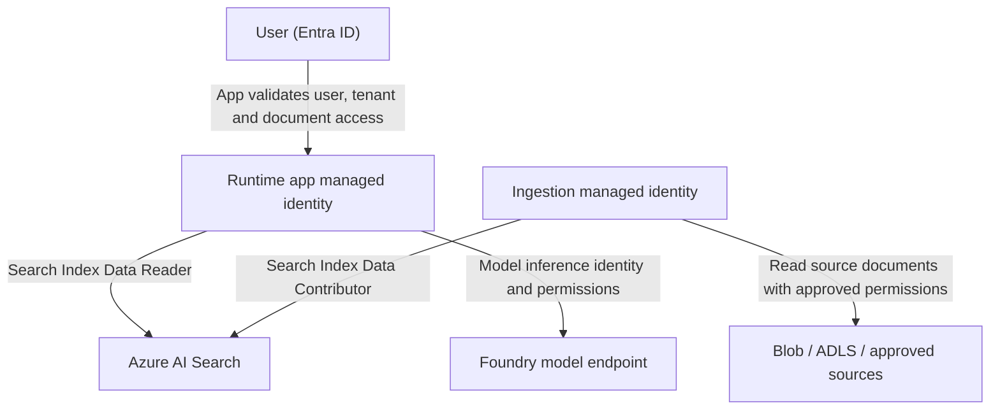

# Azure service-specific security controls

**Validation state:** Configurations to implement and verify, not claims that the current repository deploys these services.

| Service / component | Control recommendation | Enforcement owner and evidence | Key limitation |
|---|---|---|---|
| **Microsoft Entra ID** | Validate signed tokens, issuer/audience/expiry; enforce MFA/Conditional Access policies appropriate to users; trustworthy group expansion | Identity team + app; rejected tokens, CA/sign-in events | Entra authentication does not authorize a document by itself |
| **App Service or Container Apps** | Restrict public ingress as appropriate; managed identity; server-side tenant/user/group authorization; secrets absent from source/browser | App/platform team; denial events, identity and network configuration | RAG document enforcement is custom app logic unless verified managed integration |
| **Azure AI Search** | Entra/RBAC data-plane access; Search Index Data Reader for query runtime, Contributor for ingesters; app-managed security filters or supported native permission model | Search/platform team; index fields, roles, query filters, denied-document tests | `search.in` string matching is **not** an identity system; native ACL, SharePoint and label approaches are documented as preview |
| **Blob / ADLS Gen2** | Private connectivity as supported, scoped data RBAC/ACL, source-permission lineage and change events | Data owner; access-denied and revocation tests | Source ACL and Search index ACL are not automatically equivalent or perfectly synchronized |
| **SharePoint / Microsoft 365** | Source owner permissions and suitable approved indexing route, permission refresh | Content team; permission sync logs and user denial | Search SharePoint ACL ingestion has preview conditions, including synchronization caveats |
| **Microsoft Purview** | Discover/classify, apply appropriate labels and DLP/governance policies in supported services | Data governance; classification and policy evidence | Azure AI Search Purview label-aware query enforcement is **preview** and requires supported ingestion/query configuration; not a universal RAG guard |
| **Microsoft Foundry / Azure OpenAI model** | Model-inference identity scoped to permitted deployments; model safety/evaluations and approved logging/network settings | AI platform; model deployment permissions and evaluation output | Model safety and prompt delimiters don't enforce document ACLs |
| **Azure Key Vault** | Prefer managed identities; scoped vault permissions; avoid storing keys in code, logs or browser | Platform team; access audit and secret rotation plan | Restricting secrets doesn't prevent authorized-but-malicious output |
| **Azure Private Link, DNS, firewall** | Verify private routes end-to-end for supported resources and forbid unintended public fallback | Networking; DNS resolutions, effective config and packet/connection tests | Private networking isn't a substitute for user authorization |
| **Azure Monitor / Log Analytics** | Enable Search/Foundry/app diagnostics; emit **application-side** authorization and evidence events | SecOps; correlated and redacted test traces | Search diagnostics do **not** log end-user identity for each document query |
| **Microsoft Sentinel (optional)** | Correlate app authorization denials, Search diagnostics, identity events and ingestion changes | SOC; sample detection firing | Sentinel is investigation/detection, not request-time enforcement |

## Runtime vs ingestion identity diagram

Do not grant Search administration or ingestion write privileges to the query-runtime identity unless requirements explicitly justify them. Assign rights at the most specific supported scope and confirm per-index scoping where required.

## Authorization modes: feature-status review

| Approach | Status in Microsoft guidance (2026-10 review) | Operational implications |
|---|---|---|
| **App-managed string security filters** | Established, API-agnostic approach | Requires trusted principals and source ACL fields, test-driven enforcement, freshness handling |
| **ADLS Gen2 POSIX ACL/Blob RBAC metadata** | Native query-time permissions in **preview** | Verify ingestion limits, supported sources, query token headers, RBAC/ACL precedence |
| **SharePoint ACL ingestion** | **Preview** | Confirm group support and refresh behavior; do not assume permission deltas automatically propagate |
| **Purview sensitivity labels for Search** | **Preview** | Label ingestion, policy and end-user query token behavior must be validated for the selected integration |
| **Foundry-specific managed knowledge retrieval** | Depends on selected Foundry/Search architecture and feature availability | Verify separately; never infer label/ACL policy flows from a product logo |

Microsoft source references: [document-level access overview](https://learn.microsoft.com/azure/search/search-document-level-access-overview), [string security filters](https://learn.microsoft.com/azure/search/search-security-trimming-for-azure-search), [Search RBAC roles](https://learn.microsoft.com/azure/search/search-security-rbac), [Foundry architecture](https://learn.microsoft.com/azure/ai-foundry/concepts/architecture).

## Security control acceptance criteria

- Runtime managed identity can't modify Search index content or retrieve admin keys.
- Ingestion managed identity can't administer Foundry model deployments or retrieve unrelated tenants' data.
- Public routes are denied for services intended to be private, **tested end-to-end**.
- Every result supplied to the model is associated with a **validated current authorization decision**.
- Allowed data labels and handling requirements are verified at each specific data source/integration, not assumed.
- Application events link request, permission decision, citation IDs and response status without plaintext sensitive chunks.

See [runbook](../validation/README.md) for repeatable evidence requirements.
