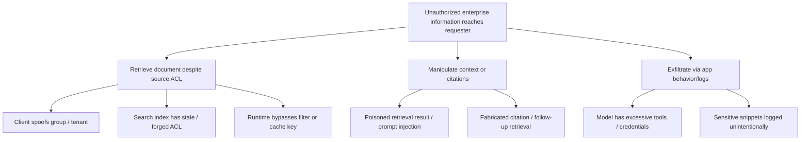

# Secure Enterprise RAG — Threat model & MITRE ATLAS mapping (V2)

**Threat model state:** architectural assessment, *not* a completed red-team or deployment assessment.  
**ATLAS review date:** 2026-10-25 · Technique identifiers were cross-checked with MITRE ATLAS and Microsoft's 2026 AI attack technique catalog. [Current MITRE ATLAS matrix](https://atlas.mitre.org/) · [Published technique data](https://github.com/mitre-atlas/atlas-data).

## Assets, adversaries, entry points

**Protect:** source documents and ACLs, indexed chunks/vectors, system instructions, model/embedding endpoints, user/session identity, API/service credentials, citations/history/caches, and audit evidence.

**Possible adversaries:** authenticated insider with limited access, compromised user account, malicious content editor, tenant-crossing attacker, attacker controlling an external source to be indexed, and adversary influencing the ingestion pipeline.

**High-risk entry points:** user prompt, SharePoint/ADLS/Blob files, ingestion APIs, embedding/ranking artifacts, authorization filters, indexed metadata, cache, model response citations, browser/server logs.

## Attack paths and validated technique IDs

| Threat scenario / path | ATLAS technique | Boundary / risk | Prevention and detection | Test |
|---|---|---|---|---|
| Malicious text in an indexed document tells model to ignore instructions or expose hidden content | [**AML.T0051.001 — LLM Prompt Injection: Indirect**](https://atlas.mitre.org/techniques/AML.T0051.001) | TB-3/TB-6 · crossed instruction/data boundary | Do not elevate retrieved text to system/tool instructions; isolate tools and validate actions; inspect responses | **RAG-03** |
| Attacker crafts highly ranked document to manipulate what retrieval returns | [**AML.T0066 — Retrieval Content Crafting**](https://atlas.mitre.org/techniques/AML.T0066) | TB-3 · attacker-controlled source selected as evidence | Source trust and provenance; ingestion controls; result sanity checks | **RAG-06** |
| Attacker plants/changes content in RAG corpus to persistently bias model context | [**AML.T0070 — RAG Poisoning**](https://atlas.mitre.org/techniques/AML.T0070) | TB-3 · index/content integrity | Restrict ingestion writes, verify provenance and change history, monitor churn | **RAG-06** |
| Model reproduces sensitive information from accessible but inappropriate context | [**AML.T0057 — LLM Data Leakage**](https://atlas.mitre.org/techniques/AML.T0057) | TB-5/TB-6 · disclosure path | Enforce ACL, minimize context, guard outputs and logs; red-team under realistic prompts | **RAG-01, RAG-03, RAG-05** |
| User attempts to extract hidden model instruction hierarchy | [**AML.T0056 — Extract LLM System Prompt**](https://atlas.mitre.org/techniques/AML.T0056) | TB-6 · instructions disclosure | Avoid putting secrets in prompts; minimize and test output exposure | **RAG-07** |
| Malicious content is placed in an application likely to be indexed later | [**AML.T0093 — Prompt Infiltration via Public-Facing Application**](https://atlas.mitre.org/techniques/AML.T0093) | TB-3 · upstream content insertion | Content owner validation, ingestion policy, provenance; red-team with synthetic uploads | **RAG-06** |

### Important mapping discipline

**Cross-tenant access bypass, token validation failures, stale ACLs, overly broad managed identities, and insecure logging are first and foremost traditional cloud/app security failures.** They can enable ATLAS outcomes (such as LLM data leakage), but we do not assign a fabricated ATLAS technique to every software authorization bug.

**Injection success is stochastic and environment dependent.** Tests must involve the actual deployed application/model, repeated scenarios, tool visibility, and observed output. Merely including a delimiter in the prompt or passing an offline Python unit test cannot demonstrate injection resistance.

## Attack tree: unauthorized disclosure

## Detect and respond

- **Access decisions:** repeated denies, unknown groups, mismatched tenants, revoked-doc requests, spikes in cross-user attempts.
- **Ingestion:** unapproved writes, document owner changes, ACL mismatches, embedding/index reprocessing surges.
- **AI behavior:** retrieval of unusual documents, prompt injection evaluation signals, unexpected tool calls, suspicious citation anomalies.
- **Response:** disable affected data source or deployment path, rotate compromised workload secrets/credentials, reindex after ACL repair, purge relevant caches, preserve sanitized evidence.
- **Attribution:** Search diagnostics may lack human actor details. Emit user/tenant **pseudonymous IDs** and authorization decision in the app, correlate with service logs via trace/request IDs.

## Source review

- [MITRE ATLAS matrix](https://atlas.mitre.org/)
- [Microsoft: prompt injection and ATLAS mapping](https://learn.microsoft.com/security/zero-trust/catalog-ai-attack-techniques/prompt-injection)
- [Microsoft: grounding data compromise and ATLAS mapping](https://learn.microsoft.com/security/zero-trust/catalog-ai-attack-techniques/grounding-data-compromise)

ATLAS evolves: revalidate names/IDs before each major release and revise mappings if classifications change.
