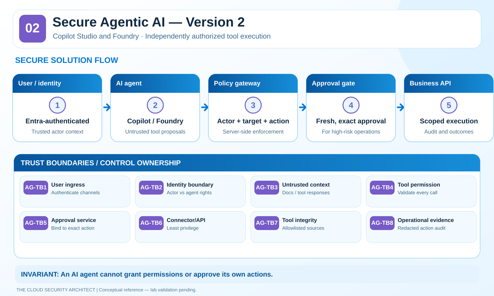
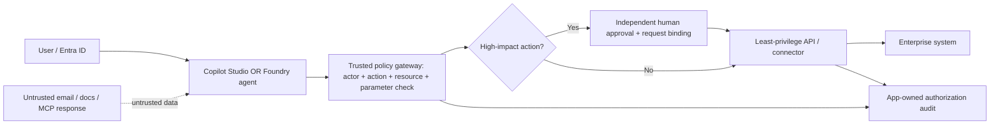

# 02 · Secure Agentic AI — Version 2

**Copilot Studio + Microsoft Foundry Agent Service | The Cloud Security Architect**

> **Maturity:** Reference design. Authorization unit tests are synthetic/offline; Copilot Studio policy enforcement, Foundry networking, approvals and tool behavior have **not** been deployed or tested in Azure. **Reviewed:** 2026-10-25.

**Defining decision:** An agent may *propose* work, but **only the tool/API owner** authorizes and executes it. Neither a prompt, tool description, connector selection, nor the agent's own identity is proof of the end user's entitlement.

## Reference library

| Deliverable | Details |
|---|---|
| [Architecture and boundaries](architecture/README.md) | Separate user, runtime, tool, approval and resource trust zones |
| [Service controls](security-controls/README.md) | **Copilot Studio vs Foundry** responsibility matrix |
| [ADR-001](adr/ADR-001-tool-authorization.md) | Server-side tool authorization and actor scoping |
| [ADR-002](adr/ADR-002-high-impact-approvals.md) | High-impact approval with request binding and replay protection |
| [Threat model](threat-model/README.md) | MITRE ATLAS agent tools, injection, data theft and poisoning |
| [Validation](validation/README.md) | AG-01–AG-10 negative tests and evidence template |
| [Offline harness](lab/README.md) | Standard-library Python policy guard with synthetic tests |
| [Operational telemetry](operations/README.md) | Traceability, response ownership, investigation signals |

## Reference request flow

**The gateway, approval workflow and logs are reference application components, not automatically provided as a universal control by Copilot Studio or Foundry.** Platform-native policies are additional layers.

## Critical platform distinction

| Platform | Native governance to evaluate | What must still be implemented or confirmed |
|---|---|---|
| **Copilot Studio (Power Platform)** | Environment roles, data policies, connector groups/blocks, HTTP restrictions, channel restrictions, auth settings; Purview supported interactions | API permissions, granular business-action authorization, exact connector credentials, approval semantics and non-Microsoft channel handling |
| **Microsoft Foundry Agent Service** | Entra/RBAC, agent identities, tools, deployment/model policies, supported networking, observability | API/tool-specific access, delegated-user vs agent identity, risk approvals, outbound/tool-specific network paths and retention |

**Never assume** a Power Platform data policy automatically applies to Foundry-hosted tools, or that an Entra-enabled agent can only access data belonging to its invoking user. Scope each hop.

## Key validations

1. A low-privilege user cannot invoke a privileged tool via direct prompt, indirect injection or another connector.
2. A tool with sufficient workload privileges is still denied a business action when the invoking user's entitlement is missing.
3. A high-impact operation cannot execute without **fresh, independent, single-use approval** bound to the actor, operation, target and parameters.
4. Poisoned tool output or metadata cannot silently change an authorized destination.
5. Actions and denials remain traceable without storing raw confidential tool arguments unnecessarily.

Reference sources: [Copilot Studio data policies](https://learn.microsoft.com/microsoft-copilot-studio/admin-data-loss-prevention), [Copilot Studio governance](https://learn.microsoft.com/microsoft-copilot-studio/security-and-governance), [Foundry Agent Service](https://learn.microsoft.com/azure/ai-foundry/agents/overview), [Agent networking](https://learn.microsoft.com/azure/foundry/agents/concepts/agents-networking-deep-dive).
