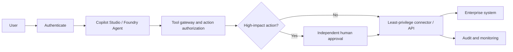

# 02 · Secure Agentic AI with Copilot Studio & Azure AI Foundry

**Status: Conceptual reference design.**

**Design rule:** agent instructions are not an authorization boundary. Validate claims, parameters and tool scopes server-side. Use independent approval for high-impact operations. Treat retrieved documents, emails, and API results as untrusted input.

Copilot Studio connector/environment policies and Foundry agent security configurations are distinct; verify each platform's controls.

[Threat model](threat-model/README.md) · [Validation](validation/README.md)
