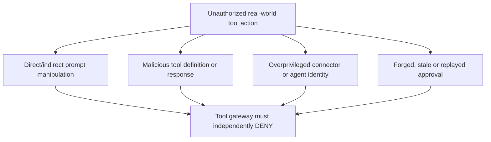

# Agentic AI V2 — Threat model and MITRE ATLAS

**State:** Design mapping. No red-team execution. **ATLAS reviewed:** 2026-10-25.

**Assets:** user/agent/connector identities, tool definitions/MCP servers, enterprise data, system prompts, human approval store, business APIs, event triggers, audit records.

**Attackers:** outsider invoking an exposed agent, insider without tool entitlements, malicious document sender, poisoned MCP/tool provider, compromised maker or broadly privileged connector owner.

| Attack path | Verified ATLAS mapping | Control boundary | Negative test |
|---|---|---|---|
| Email or retrieved knowledge tells agent to invoke a tool with forbidden arguments | [AML.T0051.001 — LLM Prompt Injection: Indirect](https://d3fend.mitre.org/offensive-technique/attack/AML.T0051.001/) | AG-TB3/4 | AG-02 |
| Adversary induces connected agent to call an API they cannot directly access | [AML.T0053 — AI Agent Tool Invocation](https://d3fend.mitre.org/offensive-technique/attack/AML.T0053/) | AG-TB4/6 | AG-01 |
| Tool/MCP metadata, implementation or response is changed to maintain malicious behavior | [AML.T0110 — AI Agent Tool Poisoning](https://d3fend.mitre.org/offensive-technique/attack/AML.T0110/) | AG-TB7 | AG-08 |
| Agent uses a legitimate write tool to transmit secret data to an unwanted destination | [AML.T0086 — Exfiltration via AI Agent Tool Invocation](https://d3fend.mitre.org/offensive-technique/attack/AML.T0086/) | AG-TB4/6 | AG-09 |
| Prompt-induced agent repeatedly consumes resources or invokes expensive tools | [AML.T0034 — Cost Harvesting](https://d3fend.mitre.org/offensive-technique/attack/AML.T0034/) | AG-TB4/8 | AG-10 |
| A connected agent reveals sensitive data through unauthorized tool output | [AML.T0057 — LLM Data Leakage](https://d3fend.mitre.org/offensive-technique/attack/AML.T0057/) | AG-TB3/6 | AG-05 |

**Traditional cloud controls also matter:** token audience mismatch, cross-tenant authorization and approval replay are conventional identity/API issues. They may facilitate an ATLAS attack; don't invent a technique for each bug.

**Defense layers:** independently authenticated actor, least-privileged connections, API authorization, input validation, tool allowlists, human approval, output minimization, controlled egress, logging, monitoring and measured evaluations.

MITRE technique IDs and definitions should be rechecked at release time against [MITRE ATLAS](https://atlas.mitre.org/) and [D3FEND cross-references](https://d3fend.mitre.org/).
