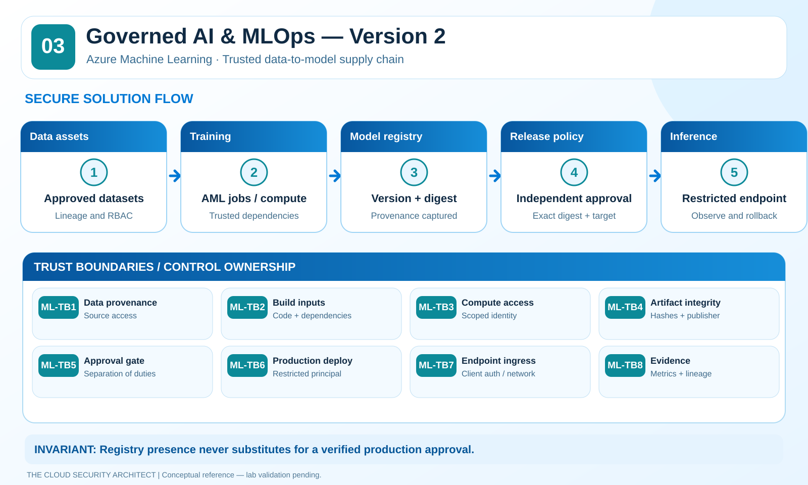
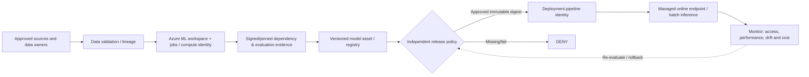

# 03 · Governed Azure AI & MLOps — Version 2

**Azure Machine Learning + Microsoft Foundry | The Cloud Security Architect**

> **Maturity:** Conceptual enterprise reference plus offline policy examples. **No Azure ML/Foundry resources deployed; no production or lab evidence.** Technical review: 2026-10-25.

**Defining architectural decision:** Model assets are not equivalent to approved production releases. Promote an **immutable, identified artifact** only after independent checks for provenance, trusted dependencies, security/quality evaluations, explicit approval, and scoped deployment access.

## Technical reference index

| Asset | What it explains |
|---|---|
| [Architecture and boundaries](architecture/README.md) | Dataset → jobs → artifacts → model registry → gates → endpoint |
| [Azure service controls](security-controls/README.md) | AML workspace, compute, identity, network, ACR, Key Vault, Storage, endpoints |
| [ADR-001: immutable promotion](adr/ADR-001-artifact-provenance-and-promotion.md) | Trusted registry alone isn't an approval gate |
| [ADR-002: isolation and identity](adr/ADR-002-workspace-identity-and-network-isolation.md) | Distinguish data scientist, compute, workspace and endpoint identities |
| [Threat model and MITRE ATLAS](threat-model/README.md) | Poisoning, supply chain, malicious weights and exposure |
| [Validation runbook](validation/README.md) | ML-01–ML-10 and sanitized evidence template |
| [Offline release-policy harness](lab/README.md) | Standard-library tests for artifact/release approvals |
| [Operations](operations/README.md) | Model provenance, release evidence and response |

## Architecture flow

## Security ownership per asset

| Asset | Access boundary | One falsifiable security requirement |
|---|---|---|
| **Dataset/labels** | Data owner + Storage ACL/RBAC + compute access | Unauthorized training job can't read sensitive dataset |
| **Training code/dependencies** | Git/build image and job submission permissions | Unapproved dependency/image change is caught before deployment |
| **Compute identity** | Per-job/compute role assignments | Job cannot fetch unrelated secrets or storage |
| **Model weights/registry** | Provenance and version access | Tampered artifact or unauthorized model version fails promotion |
| **Release pipeline** | Isolated CI/CD principal and approval system | Model author cannot silently deploy to production |
| **Inference endpoint** | Entra auth + endpoint/network policy | Unauthenticated caller denied; egress restrictions tested |
| **Monitoring data** | Audit, privacy and retention controls | Security/quality evidence retained without sensitive payload logging |

## Microsoft Foundry and Azure ML aren't identical workspaces

Azure Machine Learning has its own **workspace, managed network, compute, registry, datastores, and online endpoint** concepts. Foundry projects, agents and model deployments can have different identities and network configuration. This V2 focuses on the **Azure ML v2 training/registry/endpoint path** and treats Foundry model endpoints as a separate integration choice to validate, **not** as an identical endpoint to Azure ML managed online endpoints.

## Validation status

The Python gate example checks an immutable artifact digest, allowed provenance, policy version, evaluation decision, reviewer separation and deployment scope. It is intentionally **not** an Azure SDK/CI pipeline. Promotion evidence requires the real service to reject bad actors/artifacts, not only a helper returning False.

Source references: [Azure ML identity](https://learn.microsoft.com/azure/machine-learning/how-to-use-managed-identities), [managed network](https://learn.microsoft.com/azure/machine-learning/how-to-managed-network), [managed online endpoint auth](https://learn.microsoft.com/azure/machine-learning/how-to-authenticate-online-endpoint?view=azureml-api-2), [MLOps registries](https://learn.microsoft.com/azure/machine-learning/concept-machine-learning-registries-mlops?view=azureml-api-2).
