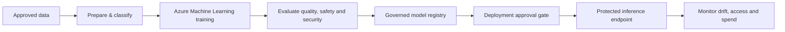

# 03 · Governed Azure AI & MLOps

**Status: Conceptual reference design.**

Treat datasets, training pipelines, model weights, registries, build dependencies, evaluation artifacts, and inference endpoints as **separately protected resources**. Apply scoped identity, data governance, provenance checks, approved deployment paths, network boundaries and telemetry.

[Threat model](threat-model/README.md) · [Validation](validation/README.md)
