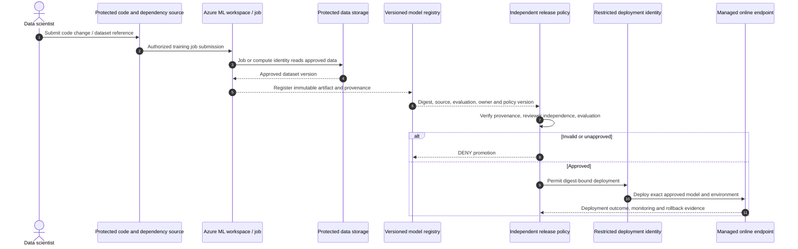

# Governed AI & MLOps V2 — Architecture walkthrough and trust boundaries

## Reference pattern: isolated dev → approved registry → restricted production

The goal is not to assume all model artifacts are trusted simply because Azure ML registered them. A model is a **versioned asset**; production promotion is a **separate risk decision**.

| Boundary | Crossing | Enforcement point | Test |
|---|---|---|---|
| **ML-TB1** | Source/label store → approved dataset | Data owner, Storage RBAC/ACL, provenance | Unapproved user/job cannot read dataset |
| **ML-TB2** | Developer Git/notebook → training pipeline | Git protections, jobs authorization, dependency allowlist | Unknown dependency/image rejected |
| **ML-TB3** | Workspace/jobs → compute + Azure dependencies | AML RBAC, job/compute MI, managed network and DNS | Compute can't reach unrelated data/secrets |
| **ML-TB4** | Training result → model registry | Artifact provenance, immutable digest, registry write role | Tampered model fails provenance |
| **ML-TB5** | Registry → release gate | Approved image+model digest, evaluation evidence, two-person control | Author cannot self-promote |
| **ML-TB6** | Release pipeline → managed online endpoint | Pipeline identity and endpoint rights; version pinning | Unapproved model isn't deployed |
| **ML-TB7** | Consumer → online endpoint | Entra authentication where supported, RBAC scoring rights, endpoint network | Unauthorized scoring denied |
| **ML-TB8** | Logs, features, metrics → monitoring / responders | Minimize logged data; privacy, anomaly and drift controls | Sensitive features not exposed in logs |

## End-to-end sequence

## Identity matrix (must validate actual mode)

- **Human data scientist:** workspace rights for jobs/models, only approved data access.
- **Workspace identity:** Azure ML service dependencies (Storage, ACR, Key Vault) according to configuration.
- **Compute/job identity:** access training data and images **only within workload scope**. Azure ML supports multiple paths for data access; never presume the scientist's user token is always the same as the job identity.
- **CI/CD release identity:** distinct principal with production-deploy rights; authors should not inherit it.
- **Endpoint identity:** manages dependency access during serving, with immutability and role considerations documented for endpoint configuration.
- **Endpoint client:** for **managed online endpoints**, prefer `aad_token` / Entra scoring authorization in production where supported; Azure ML docs distinguish key/`aml_token`/`aad_token`. Verify chosen endpoint type.

## Network distinctions

1. Secure workspace/API entry, training compute access to data dependencies, **and** inference ingress/egress separately.
2. Managed virtual network isolation can be selected for AML workspaces, with private outbound endpoints and restrictions appropriate to supported dependencies. Check actual isolation mode; `allow_internet_outbound` is **not** deny-all.
3. Managed online endpoints have separate inbound `public_network_access` from workspace managed-network outbound connectivity; test both.
4. Private endpoint connectivity depends on DNS, resource configuration, supported region/SKU, and service side access. Key Vault trusted Microsoft services exception may be required for Azure ML service operations per Microsoft docs.
5. A registry can facilitate cross-workspace sharing, but **does not by itself require promotion approval**.

## Design invariants

- No artifact with unknown provenance, unapproved evaluation, or mismatched digest is promoted.
- Author and independent approver are not the same person.
- Release pipeline identity can deploy only allowed workspace/endpoints and approved versions.
- No sensitive feature payloads are stored in ordinary application traces by default.
- Revocations, rollback, approval expiry, compromised dependencies and model lifecycle are operationally owned.

Sources: [Azure ML secured workspace](https://learn.microsoft.com/azure/machine-learning/how-to-network-security-overview), [managed network](https://learn.microsoft.com/azure/machine-learning/how-to-managed-network), [registries](https://learn.microsoft.com/azure/machine-learning/concept-machine-learning-registries-mlops?view=azureml-api-2), [endpoint network isolation](https://learn.microsoft.com/azure/machine-learning/concept-secure-online-endpoint?view=azureml-api-2).
