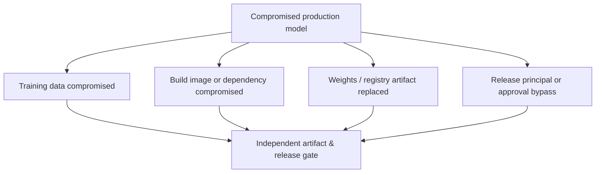

# Azure AI/MLOps V2 — Threat model and MITRE ATLAS

**Status:** Threat assessment / reference only. **ATLAS IDs reviewed:** 2026-10-25.

**Assets:** regulated training sources, labels/feature stores, notebooks and source control, dependencies and container images, compute identities, jobs, model weights, evaluation results, registry, deployment identities, serving endpoints, telemetry.

| Attack/failure path | Verified MITRE ATLAS mapping | Prevention and negative test |
|---|---|---|
| Adversary poisons or replaces a dataset entering training | [AML.T0010.002 — AI Supply Chain Compromise: Data](https://d3fend.mitre.org/offensive-technique/attack/AML.T0010.002/) | Validate source provenance, version and data access; **ML-02 / ML-05** |
| Compromised training library / ML dependency enables malicious pipeline | [AML.T0010.001 — AI Supply Chain Compromise: AI Software](https://d3fend.mitre.org/offensive-technique/attack/AML.T0010.001/) | Pin dependencies, scan and attest build; **ML-03** |
| Substituted malicious model artifact reaches registry | [AML.T0010.003 — AI Supply Chain Compromise: Model](https://d3fend.mitre.org/offensive-technique/attack/AML.T0010.003/) | Approved immutable digest/provenance; **ML-04** |
| Poisoned ACR container image is pulled during build/serving | [AML.T0010.004 — AI Supply Chain Compromise: Container Registry](https://d3fend.mitre.org/offensive-technique/attack/AML.T0010.004/) | Signed/verified pinned image digest, restricted publisher; **ML-03** |
| Attacker modifies weights or bundles malicious payload in a model | [AML.T0018 — Manipulate AI Model](https://d3fend.mitre.org/offensive-technique/attack/AML.T0018/) | Hash and evaluate model, unsafe artifact handling checks; **ML-04** |
| Attacker reaches model through exposed inference API | [AML.T0040 — AI Model Inference API Access](https://d3fend.mitre.org/offensive-technique/attack/AML.T0040/) | Auth/RBAC, network isolation, throttling; **ML-07** |
| Unauthorized queries run up compute/API bills | [AML.T0034 — Cost Harvesting](https://d3fend.mitre.org/offensive-technique/attack/AML.T0034/) | Cost/run quotas and monitoring; **ML-10** |

**Cloud security overlap:** identity privilege escalation, network misconfigurations, log exposure and unsafe CI/CD are traditional security risks; they can enable ATLAS techniques but **should not be mislabeled** as novel AI techniques.

## Detection and response

Track new dataset owners, sensitive blob read failures, component/image registry changes, unapproved model registration, unexpected model digest at endpoint, unusual inference or egress, evaluation drift, deployment-role changes and pipeline bypass. Quarantine affected model/registry version, revoke write rights, rollback to a verified artifact, freeze provenance evidence, re-evaluate source data and notify owners.

Recheck [MITRE ATLAS](https://atlas.mitre.org/) and [ATLAS technique data](https://github.com/mitre-atlas/atlas-data) as catalog versions evolve. Do not report mappings as a completed assessment.
