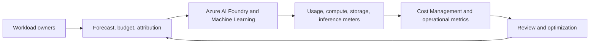

# 04 · Azure AI FinOps & Cost Optimization

**Status: Conceptual reference design.**

**Cost drivers:** model inference (model-specific usage/billing), GPU/CPU training time, storage, Azure AI Search, networking, monitoring and related services.

**Savings levers:** right-size models/compute, schedule idle development resources, batch or cache where safe, choose appropriate GPU and Spot for interruptible work, tune retention and evaluate commitment discounts against actual demand.

**Do not claim a fixed percentage of savings without a normalized baseline.** Cost alerts are not guaranteed hard spending caps.

[Budgets & controls](budgets-and-policy/README.md) · [Cost models](cost-models/README.md)
