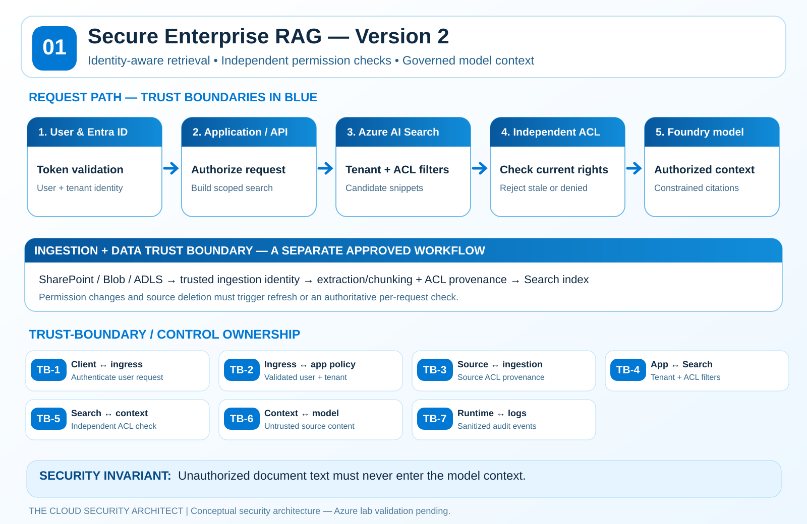
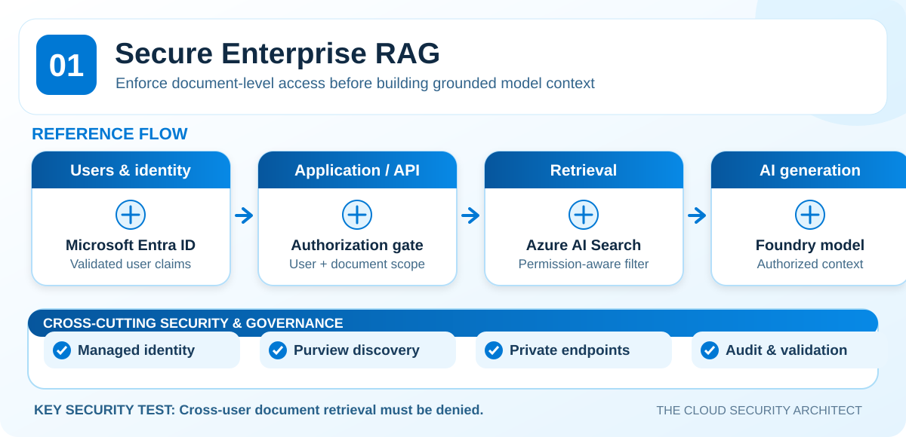
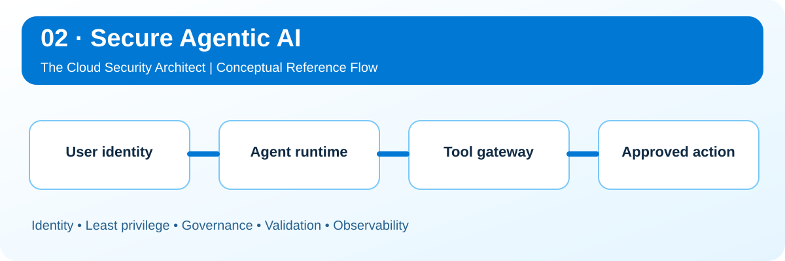
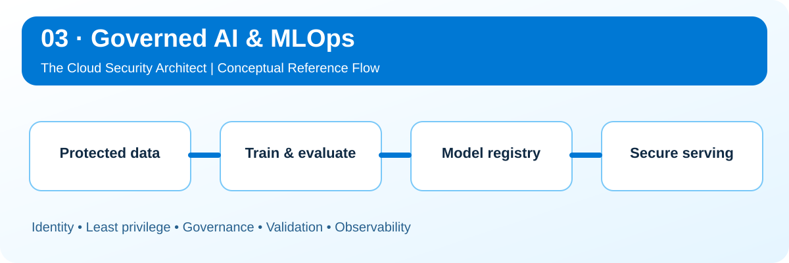
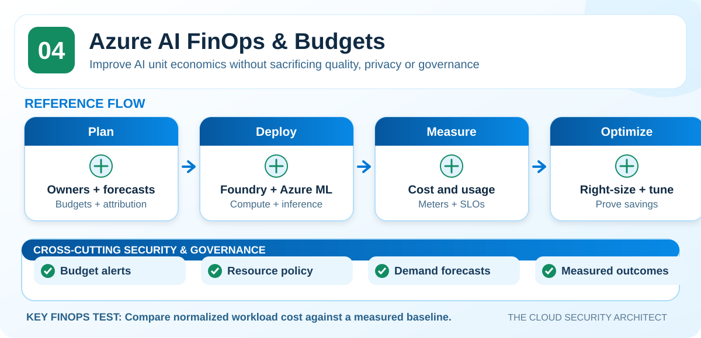

<p align="center">
  
</p>

<h1 align="center">Azure AI Security Reference Architectures</h1>
<p align="center"><strong>Secure by design. Governed by policy. Validated with evidence.</strong></p>
<p align="center">
  <a href="#architecture-library">Explore architectures</a> ·
  <a href="#security-and-governance-principles">Core controls</a> ·
  <a href="#validation--evidence">Validation</a> ·
  <a href="#roadmap">Roadmap</a>
</p>

---

## Why this repository exists

Azure AI architecture is more than connecting models to enterprise data. Production-oriented designs require **explicit trust boundaries, identity-aware access, sensitive-data governance, repeatable validation, and cost accountability**.

This repository is a practical, security-first reference library developed by **The Cloud Security Architect**. It focuses on **why** controls are needed, **where** they are enforced, **how** they can fail, and **what evidence** should establish that they work.

**Intended audience:** Cloud Security Architects, Enterprise Architects, Security Engineers, AI Platform Engineers, MLOps teams, and security/governance leaders.

> [!IMPORTANT]
> **Maturity: Reference designs — not yet lab validated.** Diagrams and test plans are architectural starting points, not representations of a deployed or independently verified environment. Validate service versions, regional support, licensing, preview status, and all control claims before production use.

## Featured release · Secure Enterprise RAG V2

**[Explore Version 2 — trust boundaries, Azure controls, MITRE ATLAS and security tests](01-secure-enterprise-rag/README.md)**

[](01-secure-enterprise-rag/README.md)

**New:** Seven documented trust boundaries, retrieval authorization decisions, permissions freshness, Azure service controls, threat mappings, a test runbook, and a standard-library Python authorization example. Azure lab validation remains pending.

## Architecture library

<table>
  <tr>
    <td width="50%" valign="top">
      <a href="01-secure-enterprise-rag/README.md"></a>
      <h3>01 · <a href="01-secure-enterprise-rag/README.md">Secure Enterprise RAG</a></h3>
      <p><strong>Architecture question:</strong> Can a user retrieve or cite documents they are not permitted to access?</p>
      <p>Identity-aware retrieval, document authorization, prompt-injection boundaries, private networking, and sensitive-data governance.</p>
      <a href="01-secure-enterprise-rag/adr/ADR-001-retrieval-authorization.md">Decision record</a> · <a href="01-secure-enterprise-rag/threat-model/README.md">Threats</a> · <a href="01-secure-enterprise-rag/validation/README.md">Tests</a>
    </td>
    <td width="50%" valign="top">
      <a href="02-secure-agentic-ai/README.md"></a>
      <h3>02 · <a href="02-secure-agentic-ai/README.md">Secure Agentic AI</a></h3>
      <p><strong>Architecture question:</strong> What prevents an agent from making an unauthorized tool call?</p>
      <p>Copilot Studio and Foundry agents, server-side tool permissions, connector controls, approval gates, and action traceability.</p>
      <a href="02-secure-agentic-ai/threat-model/README.md">Threats</a> · <a href="02-secure-agentic-ai/validation/README.md">Tests</a>
    </td>
  </tr>
  <tr>
    <td valign="top">
      <a href="03-governed-ai-mlops/README.md"></a>
      <h3>03 · <a href="03-governed-ai-mlops/README.md">Governed AI &amp; MLOps</a></h3>
      <p><strong>Architecture question:</strong> Can an unapproved model, dataset, or pipeline reach production?</p>
      <p>Dataset protections, model integrity, lineage, pipeline permissions, deployment approval, and production monitoring.</p>
      <a href="03-governed-ai-mlops/threat-model/README.md">Threats</a> · <a href="03-governed-ai-mlops/validation/README.md">Tests</a>
    </td>
    <td valign="top">
      <a href="04-ai-finops-cost-optimization/README.md"></a>
      <h3>04 · <a href="04-ai-finops-cost-optimization/README.md">Azure AI FinOps &amp; Budgeting</a></h3>
      <p><strong>Architecture question:</strong> Can teams attribute and reduce AI spend without harming quality or security?</p>
      <p>Cost drivers, workload tagging, budget alerts, model and compute optimization, and savings measurement.</p>
      <a href="04-ai-finops-cost-optimization/budgets-and-policy/README.md">Budget controls</a> · <a href="04-ai-finops-cost-optimization/cost-models/README.md">Cost model</a>
    </td>
  </tr>
</table>

## What each architecture provides

| Deliverable | Practical purpose |
|---|---|
| **Architecture flow** | Components, data movement, and control enforcement points |
| **Architecture decisions (ADRs)** | Tradeoffs, alternatives, and security rationale |
| **Threat modeling** | Likely attack paths and mitigations, including MITRE ATLAS where verified |
| **Negative-security tests** | Prove what should *not* be possible |
| **Governance guidance** | Identity, Purview, policy, monitoring, and accountability |
| **Operational/FinOps context** | Cost, telemetry, deployment lifecycle and constraints |

The [shared security-control matrix](docs/security-control-matrix.md) connects risks and controls to evidence requirements.

## Security and governance principles

| Principle | How to apply it |
|---|---|
| **Identity is not authorization** | Authenticate with Entra ID; enforce data and tool permissions separately |
| **Sensitive retrieval must be scoped** | Apply data access checks **before** retrieved content enters a model prompt |
| **Agents do not grant privileges** | Validate every tool/action at an independent service boundary |
| **AI artifacts are protected assets** | Scope training data, pipelines, model weights and endpoints separately |
| **Governance is integration-specific** | Verify what Microsoft Purview labels and policies actually cover |
| **Visibility is not a spending cap** | Pair Azure Cost Management budgets with operational guardrails |
| **Evidence over checkmarks** | Run tests and record actual observations, not just intended configurations |

### Platform-specific security distinctions

- **Microsoft Entra ID:** sign-in and workload identity are foundational; app-specific document and tool authorization still matter.
- **Microsoft Purview:** classification, labels and governance can cover supported systems; they do **not**, by themselves, universally enforce authorization for arbitrary RAG or agent tools.
- **Azure AI Search:** security-filter patterns exist, while native identity/ACL integrations vary by feature and status. Confirm your chosen approach and permissions synchronization.
- **Copilot Studio:** Power Platform data policies can constrain supported connectors, channels, and authentication-related settings; test policy outcomes in your environment.
- **Azure budgets:** Cost Management alerts **notify**, but should not be represented as a guaranteed hard stop for all AI consumption.

## Validation & evidence

The lab work starts with **Secure Enterprise RAG**, prioritizing three falsifiable claims:

1. A user **cannot retrieve or cite** another user's protected document.
2. A malicious indexed document **cannot elevate privileges** or instruct the system to exfiltrate secrets.
3. The solution generates **sanitized audit evidence** linking identity, retrieval decisions, relevant events, and outcomes.

See the [RAG negative-security validation plan](01-secure-enterprise-rag/validation/README.md), [architecture ADR](01-secure-enterprise-rag/adr/ADR-001-retrieval-authorization.md), and [publishing checklist](docs/publishing-checklist.md).

### Evidence maturity

| Level | Evidence |
|---|---|
| **Reference** (current) | Draft architecture, assumptions, documented test objectives |
| **Technically reviewed** | Current product documentation and implementation constraints checked |
| **Lab validated** | Reproducible negative tests, observed results, and sanitized screenshots/logs |
| **Operational example** | Detection, incident response, maintenance, and FinOps monitoring demonstrated |

## Repository map

```text
.
├── assets/                          # Branded, scalable SVG reference graphics
├── docs/                            # Shared security matrix and review standards
├── 01-secure-enterprise-rag/        # RAG authorization, threat model, validation
├── 02-secure-agentic-ai/            # Agent/tool access controls and testing
├── 03-governed-ai-mlops/            # Data, models, pipelines and endpoint security
├── 04-ai-finops-cost-optimization/  # Budgets, optimization and cost modeling
├── CONTRIBUTING.md
└── LICENSE
```

## Roadmap

- [x] Create architecture library, navigation, gallery, and first-pass documentation
- [x] Publish scalable SVG architecture preview graphics
- [ ] Review Azure-specific configuration and feature status against official documentation
- [ ] Add full technical diagrams with explicit network and trust boundaries
- [ ] Build a minimal Secure RAG lab with repeatable deployment instructions
- [ ] Capture **sanitized** negative-test results and audit evidence
- [ ] Map applicable verified MITRE ATLAS techniques
- [ ] Add editable templates and FinOps measurement workbook
- [ ] Publish companion architecture analysis on **The Cloud Security Architect** Substack

## Technical references

- [Microsoft Learn · Azure AI Search document-level access control](https://learn.microsoft.com/azure/search/search-document-level-access-overview)
- [Microsoft Learn · Copilot Studio data policies](https://learn.microsoft.com/microsoft-copilot-studio/admin-data-loss-prevention)
- [Microsoft Learn · Azure Cost Management budgets](https://learn.microsoft.com/azure/cost-management-billing/costs/tutorial-acm-create-budgets)

Use these as starting points; documentation and features evolve.

---

### About The Cloud Security Architect

Independent, practitioner-focused reference architectures covering **Azure security, identity, Zero Trust, AI security, security operations, and governance**. The priority is actionable design reasoning and **validation evidence**, not decorative compliance claims.

[GitHub profile](https://github.com/mhartson310) · [Contributing](CONTRIBUTING.md) · [Visual style](docs/visual-style-guide.md) · [License](LICENSE)

<sub>Independent technical project; not official Microsoft architecture guidance. Product names and marks remain the property of their respective owners.</sub>
